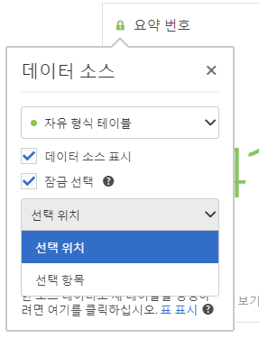

# 데이터 소스 관리 {#manage-data-sources}

>[!CONTEXTUALHELP]
>id="workspace_freeformtable_lockselection"
>title="선택 사항 잠금"
>abstract="이 설정을 활성화하여 시각화를 데이터 소스의 선택한 위치 또는 선택한 항목에 잠급니다."

>[!CONTEXTUALHELP]
>id="workspace_freeformtable_lockselection_showtable"
>title="테이블 표시"
>abstract="**[!UICONTROL 테이블 표시]**&#x200B;를 선택하면 원본 데이터 원본과 별도로 현재 시각화에 대한 새 데이터 원본이 생성됩니다."

>[!CONTEXTUALHELP]
>id="workspace_freeformtable_showtable"
>title="테이블 표시"
>abstract="**[!UICONTROL 테이블 표시]**&#x200B;를 선택하면 현재 시각화에 대한 새 데이터 소스를 생성하여 원래 데이터 소스와 분리시킬 수 있습니다."

Analysis Workspace의 각 시각화는 데이터 소스, 일반적으로 자유 형식 테이블을 기반으로 합니다. 시각화를 동기화하면 시각화에 해당하는 자유 형식 테이블 또는 데이터 소스와 시각화가 해당 테이블의 특정 행에 잠겨 있는지 여부를 제어할 수 있습니다.

>[!TIP]
>
>시각화 제목 옆의  색상을 통해 연관된 시각화를 구분할 수 있습니다. 색상이 일치하면 시각화가 동일한 데이터 소스를 기준으로 한다는 것을 의미합니다.
>

<!--
**Tip:** You can tell which visualizations are related by the color of the dot next to the title. Matching colors mean that visualizations are based on the same data source.

Managing a data source lets you show the data source or lock the selection. These settings determine how the visualization changes (or doesn't change) when new data comes in.

1. [Create a project](/help/analyze/analysis-workspace/home.md) with a data table and a [visualization](/help/analyze/analysis-workspace/visualizations/freeform-analysis-visualizations.md).
1. In the data table, select the cells (data source) you want to associate with the visualization.
1. In the visualization, click the dot next to the title to bring up the **[!UICONTROL Data Source]** dialog. Select **[!UICONTROL Show Data Source]** or **[!UICONTROL Lock Selection]**.

   

   Synchronizing a visualization to a table cell creates a new (hidden) table and color-codes the synchronized visualization with that table.

>[!BEGINSHADEBOX]

See  [Data source settings](https://video.tv.adobe.com/v/23729?quality=12&learn=on){target="_blank"} for a demo video.

>[!ENDSHADEBOX]

-->

## 데이터 소스 설정 구성 {#configure}

1. Analysis Workspace에서 구성할 데이터 소스 또는 잠금 설정이 있는 시각화로 이동합니다.

1. 시각화 위로 마우스를 가져간 다음 **[!UICONTROL 설정]** 아이콘 을 선택합니다.

1. **[!UICONTROL 데이터 원본]** 탭을 선택합니다.

   

1. 다음 설정 중 하나를 구성합니다.

   | 설정 | 설명 |
   | --- | --- |
   | **[!UICONTROL 데이터 소스]** | 시각화의 기반이 되는 데이터 소스를 선택합니다. |
   | **[!UICONTROL 연결된 시각화]** | 데이터 소스(자유 형식 테이블)에 연결된 모든 시각화를 나열합니다. |
   | **[!UICONTROL 데이터 소스 표시]** | 시각화에 해당하는 데이터 소스(자유 형식 테이블)를 표시하거나 숨깁니다. |
   | **[!UICONTROL 선택 잠금]** | 데이터 원본에서 현재 선택한 행에 시각화를 잠근 다음 **[!UICONTROL 선택한 위치]** 또는 **[!UICONTROL 선택한 항목]**&#x200B;을 선택합니다. [선택 잠금](#lock-selection)을 참조하세요. |

## 선택 사항 잠금 {#lock-selection}

선택 사항을 잠그면 테이블이 변경되더라도 데이터 소스에서 선택한 행에 초점을 맞춘 시각화가 유지됩니다. 예를 들어, 테이블을 정렬하거나 필터링하거나, 날짜 범위를 변경하거나, 세그먼트를 적용할 때 테이블이 변경됩니다. 잠긴 시각화는 제목 옆에 이(가) 표시됩니다.

데이터 원본의 세그먼트, 차원 또는 지표가 변경되어 잠긴 데이터가 더 이상 표시되지 않는 경우 **[!UICONTROL 테이블 표시]**&#x200B;를 선택하여 원래 데이터 원본과 별도로 시각화에 대한 새 데이터 원본을 생성합니다.

선택 영역을 잠글 때 다음 옵션 중 하나를 선택합니다.

| 옵션 | 설명 |
| --- | --- |
| **[!UICONTROL 선택한 위치]** | 시각화를 데이터 원본에서 선택한 행의 **위치**&#x200B;로 잠급니다. 이러한 위치는 해당 위치에 있는 항목이 변경되더라도 계속 시각화됩니다. 예를 들어, 상위 5개의 캠페인 이름을 캠페인에 상관없이 데이터 소스에 항상 표시하려면 이 옵션을 선택합니다.  분류 행을 잠그고 해당 행이 더 이상 테이블에 없는 경우 시각화가 표시되지 않습니다. 다시 표시하려면 테이블(예: 날짜 범위, 세그먼트 또는 필터)을 업데이트하거나 잠금 선택을 업데이트합니다. |
| **[!UICONTROL 선택한 항목]** | 데이터 원본에서 선택한 특정 **항목**&#x200B;에 대한 시각화를 잠급니다. 이러한 항목은 테이블에서 순위가 변경되더라도 계속 시각화됩니다. 예를 들어 순위 지정 방법에 관계없이 항상 동일한 5개의 캠페인 이름을 표시하려면 이 옵션을 선택합니다. |
